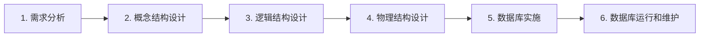

# 数据库系统概论

### **第一部分：基础篇（绪论、关系模型、关系代数与 SQL）**

#### **一、数据库系统概述与数据模型**

##### **1. 四个基本概念与数据管理发展阶段**
数据库技术的核心目标是科学地组织和存储海量数据，实现高效查询与修改，并确保数据的安全、正确、不丢失与不混乱。理解数据库系统需要首先厘清四个基础概念：
* **数据（Data）**：描述事物的符号记录（数字、文字、图像、声音等）。数据与其语义密不可分，例如数字 `20` 在不同语境下既可以表示年龄，也可以表示价格。
* **数据库（DB）**：长期储存在计算机内、有组织的、可共享的大量数据的集合。它按一定的数据模型组织和存储，具有较小的冗余度、较高的数据独立性和易扩展性。
* **数据库管理系统（DBMS）**：位于用户和操作系统之间的一层数据管理软件（如 MySQL、Oracle、SQL Server）。其主要功能包括：数据定义、数据的组织存储和管理、数据操纵、数据库的事务管理和运行管理，以及数据库的建立和维护。
* **数据库系统（DBS）**：由数据库（DB）、数据库管理系统（DBMS）、应用程序和数据库管理员（DBA）组成的完整系统。三者的包含关系为：**DBS 包含 DB 和 DBMS**（日常口语中常把 DBS 简称为数据库）。

数据管理技术经历了三个发展阶段，对比如下：

| 发展阶段 | 数据保存与共享 | 冗余度与独立性 | 核心特征 |
| :--- | :--- | :--- | :--- |
| **人工管理阶段** | 数据不长期保存、不共享 | 无独立性，数据完全依赖于程序 | 一个程序对应一组数据 |
| **文件系统阶段** | 数据可长期保存在文件中 | 共享性差、冗余度大、独立性差 | 一个文件基本对应一个应用，数据结构改变则程序必须修改 |
| **数据库系统阶段** | 面向整个组织，共享性高 | 冗余度低，具有高度的物理与逻辑独立性 | **数据整体结构化**，由 DBMS 统一管理和控制 |

数据库系统的特点可归纳为四条：**数据结构化**、**数据的共享性高（冗余度低、易扩充）**、**数据独立性高**、**数据由 DBMS 统一管理和控制**。其中，DBMS 提供的统一管理与控制具体体现为以下四种保护机制：
1. **安全性保护**：防止不合法使用造成的数据泄露或破坏。
2. **完整性检查**：保证数据语义正确、有效且相容。
3. **并发控制**：多用户同时存取同一数据时互不干扰。
4. **数据库恢复**：系统发生故障后能将数据恢复到正确状态。

##### **2. 数据模型与概念模型（E-R 图）**
数据模型是对现实世界数据特征的抽象，从现实世界到计算机世界需经过两步抽象：首先将**现实世界**抽象为信息世界的**概念模型**，再将概念模型转换为机器世界中某个具体 DBMS 支持的**逻辑模型**和**物理模型**。

数据模型由三个要素组成，其中**数据结构**是最重要的要素：
* **数据结构**：描述系统的静态特性，即数据是什么样子、彼此有什么联系。
* **数据操作**：描述系统的动态特性，主要是查询和更新（插入、删除、修改）。
* **完整性约束**：描述数据必须满足的语义规则（如“学号不能重复”）。

在信息世界的**概念模型**中，核心术语包括：**实体**（客观存在并可相互区分的事物，如一个学生）、**属性**（实体的某一特性，如学号、姓名）、**码/键（Key）**（唯一标识实体的属性集，如学号）、**域（Domain）**（属性的取值范围）以及**实体集**（同类实体的集合）。两个实体集之间的联系分为三类：**一对一（$1:1$）**（如一个班级只有一个班长）、**一对多（$1:n$）**（如一个班级有多个学生，每个学生只属于一个班级）、**多对多（$m:n$）**（如一个学生选多门课，一门课被多个学生选）。概念模型最常用的表示方法是 **E-R 图（实体-联系图）**，绘图规范为：**矩形**表示实体、**椭圆**表示属性、**菱形**表示联系，连线旁标注 $1$、$n$ 或 $m$。需特别注意，**联系本身也可以拥有属性**（例如学生与课程之间的“选修”联系具有“成绩”属性）。

在机器世界的**逻辑模型**中，常见模型有三种：**层次模型**（树形结构，每个节点最多只有一个双亲）、**网状模型**（图结构，一个节点可以有多个双亲）和**关系模型**（二维表结构）。层次模型和网状模型使用指针表示实体间的联系，存取路径对用户不透明；而**关系模型**建立在严格的数学基础上，概念单一，实体和实体间的联系全部用“关系”（即二维表）来表示，存取路径对用户完全透明（用户只需声明“要什么”，无需说明“怎么找”）。

##### **3. 数据库系统的三级模式与两级映像**
理解数据库内部结构需先区分“型（Type）”和“值（Value）”：**型**是对数据结构的描述（如学生记录由学号、姓名、年龄组成），相对稳定；**值**是型的一个具体赋值（如“李勇，20岁”），随时间不断变化。**模式（Schema）**正是对数据库中全体数据逻辑结构和特征的描述，它仅仅涉及“型”而不涉及具体的“值”。

数据库系统采用**三级模式结构**，并通过**两级映像**保障数据独立性：
* **模式（逻辑模式）**：数据库中全体数据的逻辑结构和特征的描述，是所有用户的公共数据视图（好比图书馆的总目录）。**一个数据库只有一个模式**。
* **外模式（子模式/用户模式）**：数据库用户能够看见和使用的局部数据的逻辑结构和特征的描述（好比针对不同读者的专用书单，学生只能看教材，老师还能看参考资料）。它是模式的子集，**一个数据库可以有多个外模式**。
* **内模式（存储模式）**：数据物理结构和存储方式的描述，定义数据在磁盘上的存储方式（好比书在库房第几排第几层）。**一个数据库只有一个内模式**。

三级模式之间存在两层映像：
1. **外模式/模式映像**：定义每个外模式与模式之间的对应关系（有多少个外模式就有多少个此映像）。当模式发生改变时（例如给学生表增加一个新属性），DBA 只需修改外模式/模式映像，即可使外模式保持不变，从而使依据外模式编写的应用程序无需修改，这保证了数据的**逻辑独立性**。
2. **模式/内模式映像**：定义数据全局逻辑结构与存储结构之间的对应关系（在数据库中是唯一的）。当数据的存储结构改变时（例如更换索引或将数据迁移至新磁盘），DBA 只需修改模式/内模式映像，即可使模式保持不变，应用程序同样无需修改，这保证了数据的**物理独立性**。

> **高频易错点与记忆口诀**
> * **本质区别辨析**：数据库系统与文件系统的本质区别是**数据整体结构化**，而不是“能否长期保存数据”（文件系统也能长期保存）。
> * **概念模型独立性**：E-R 模型属于信息世界的概念模型，它与具体的计算机硬件和具体的 DBMS 完全无关；判断联系类型（$1:1$、$1:n$、$m:n$）时，必须从两个方向分别观察“一个实体对应对方几个实体”。
> * **两级映像口诀**：“**靠近用户的管逻辑，靠近磁盘的管物理**”——外模式/模式映像保证**逻辑独立性**，模式/内模式映像保证**物理独立性**；外模式有多个，模式和内模式各只有一个。

---

#### **二、关系模型与三类完整性约束**

##### **1. 关系数据结构与码的概念体系**
关系模型仅有一种数据结构——**关系（Relation）**，直观上就是一张二维表。表中的每一行称为一个**元组（Tuple）**，每一列称为一个**属性（Attribute）**，属性的取值范围称为**域（Domain）**。从数学定义看，**关系是笛卡尔积的有意义子集**。例如导师有 $2$ 个、专业有 $2$ 个、研究生有 $3$ 个，三者的笛卡尔积共有 $2 \times 2 \times 3 = 12$ 个元组，但现实中真正有指导关系的只是其中几个元组，这个子集就是关系。

整门课程均以经典的学生选课数据库作为标准算例，包含以下三张表：
* **学生表 `Student(Sno, Sname, Ssex, Sage, Sdept)`**：学号、姓名、性别、年龄、所在系。
* **课程表 `Course(Cno, Cname, Cpno, Ccredit)`**：课程号、课程名、先修课号、学分。
* **选课表 `SC(Sno, Cno, Grade)`**：学号、课程号、成绩。

围绕关系的标识与关联，核心概念定义如下：
* **超码（Super Key）**：能唯一标识一个元组的属性或属性组（可能含有多余属性）。
* **候选码（Candidate Key）**：能唯一标识一个元组，且**不含多余属性**（即去掉其中任何一个属性就不再能唯一标识元组）的属性组。例如 `Student` 表中的 `Sno`（若规定不重名，则 `Sname` 也是候选码）；`SC` 表中单独的 `Sno` 或 `Cno` 都无法唯一确定一行，必须由 `(Sno, Cno)` 组合才能作为候选码。
* **主码（Primary Key）**：当一个关系有多个候选码时，从中选定一个作为主码。
* **主属性与非主属性**：包含在**任何一个候选码**中的属性称为**主属性（Prime Attribute）**；不包含在任何候选码中的属性称为**非主属性（Non-prime Attribute）**。例如在 `SC` 表中，`Sno` 和 `Cno` 是主属性，`Grade` 是非主属性。
* **全码（All-key）**：如果一个关系模式的所有属性合在一起才构成候选码，则称为全码。
* **外码（Foreign Key）**：如果关系模式 $R$ 中的属性或属性组 $F$ **不是 $R$ 的码**，但 $F$ 与另一个关系模式 $S$ 的**主码**相对应，则称 $F$ 是 $R$ 的外码。此时称 $R$ 为**参照关系（Referencing Relation）**，$S$ 为**被参照关系（Referenced Relation）**。例如 `SC` 表中的 `Sno` 是引用 `Student` 表主码的外码。外码也可以参照自身所在的表，例如 `Course` 表中的先修课号 `Cpno` 参照的就是 `Course` 表自身的主码 `Cno`。

关系具有以下基本性质：每一列的分量必须来自同一个域（同质性）；列的顺序和行的顺序均无关紧要；任意两个元组的候选码不能相同（无重复元组）；**最重要的性质是每一个分量都必须是不可再分的数据项（即表中不能有表）**，满足这一基本性质的关系称为满足**第一范式（1NF）**。

##### **2. 关系的完整性约束**
关系模型的完整性规则是对关系的某种约束条件，分为三类（其中前两类是关系模型必须满足的固有约束，称为**关系的两个不变性**，由 DBMS 自动支持）：
1. **实体完整性（Entity Integrity）**：若属性 $A$ 是基本关系 $R$ 的主属性，则 $A$ **不能取空值（`NULL`）**。原因在于主码用于唯一标识现实世界中的某个独立实体，若主码部分或全部为空，则意味着存在某个不可标识的实体，这与实体的定义自相矛盾。
2. **参照完整性（Referential Integrity）**：若属性（或属性组）$F$ 是基本关系 $R$ 的外码，它与基本关系 $S$ 的主码 $K_s$ 相对应，则对于 $R$ 中每个元组在 $F$ 上的值必须满足：**要么取空值（`NULL`）**（前提是 $F$ 的每个属性均允许为空），**要么等于 $S$ 中某个元组的主码值**。例如 `SC` 表中的学号必须是 `Student` 表中真实存在的学号。
3. **用户定义的完整性（User-defined Integrity）**：针对某一具体应用领域的语义约束（例如成绩 `Grade` 必须在 $0 \sim 100$ 之间，性别只能取“男”或“女”）。

> **高频易错点：外码究竟能不能取空值？**
> 按参照完整性规则本身，外码是可以取空值的（例如学生表 `Student` 中有外码“专业号”参照专业表，若某新生刚入学尚未分专业，其“专业号”可以取 `NULL`）。**但是**，如果该外码同时又是当前表的主属性（例如选课表 `SC` 中的 `Sno` 既是参照学生表的外码，又是 `SC` 表主码 `(Sno, Cno)` 的一部分），则必须同时受**实体完整性**约束，此时**绝对不能取空值**。

---

#### **三、关系代数（Relational Algebra）**

##### **1. 八种关系代数运算符**
关系代数是一种抽象的查询语言，其运算对象是关系，运算结果也是关系。运算符分为两大类共八种：

**第一类：传统的集合运算（从“行”的角度进行，其中并、差、交要求两个关系必须是“相容”的，即具有相同的属性个数，且对应属性取自同一个域）**
* **并（Union，$\cup$）**：$R \cup S$ 由属于 $R$ **或**属于 $S$ 的元组组成（自动去除重复元组）。
* **差（Difference，$-$）**：$R - S$ 由属于 $R$ **但不属于** $S$ 的元组组成。
* **交（Intersection，$\cap$）**：$R \cap S$ 由**既属于 $R$ 又属于 $S$** 的元组组成。可由差运算导出：$R \cap S = R - (R - S)$。
* **笛卡尔积（Cartesian Product，$\times$）**：$R \times S$ 将 $R$ 的每一行与 $S$ 的每一行两两拼接。若 $R$ 有 $k_1$ 列 $n$ 行，$S$ 有 $k_2$ 列 $m$ 行，则 $R \times S$ 有 $(k_1 + k_2)$ 列、$n \times m$ 行。

**第二类：专门的关系运算（同时涉及行和列的操作）**
* **选择（Selection，$\sigma$）**：从**行**的角度操作，挑选出满足给定逻辑条件 $F$ 的元组，记作 $\sigma_F(R)$。例如从学生表中选出年龄小于 20 岁的学生：$\sigma_{\text{Sage} < 20}(\text{Student})$。
* **投影（Projection，$\pi$）**：从**列**的角度操作，选出指定的若干属性列组成新关系，记作 $\pi_A(R)$。**特别注意：投影操作后若出现完全相同的行，必须自动取消重复行**。例如学生表有 4 名学生（2 名 CS 系、1 名 MA 系、1 名 IS 系），执行 $\pi_{\text{Sdept}}(\text{Student})$ 后只得到 `CS`、`MA`、`IS` 共 3 行。
* **连接（Join，$\bowtie$）**：从两个关系的笛卡尔积中选取属性间满足一定条件的元组。
  * **等值连接**：连接条件为 `$=$` 的连接运算（保留所有列，包括重复的同名列）。
  * **自然连接（Natural Join）**：一种特殊的等值连接，要求两个关系中进行比较的分量必须是**同名的属性组**，并且在结果中**把重复的属性列去掉**。
  * **悬浮元组与外连接**：在做自然连接时，因在对方关系中找不到匹配元组而被舍弃的元组称为**悬浮元组**（如 `Student` 与 `SC` 自然连接时，未选课的学生“王敏”和“张立”会被丢弃）。如果把悬浮元组也保留在结果中，而在其余属性上填空值（`NULL`），就称为**外连接（Outer Join）**；只保留左边关系悬浮元组的叫**左外连接（$\mathbin{\subset\!\!\!\bowtie}$）**，只保留右边关系悬浮元组的叫**右外连接（$\mathbin{\bowtie\!\!\!\supset}$）**。
* **除（Division，$\div$）**：同时从行和列的角度进行运算，专门用于解决包含“**全部**”、“**至少……所有**”语义的查询。这依赖于**象集（Images Set）**的概念：给定关系 $R(X, Y)$，当 $X$ 取某个固定值 $x_i$ 时，$R$ 中对应元组在 $Y$ 上的取值集合称为 $x_i$ 在 $R$ 中的象集 $Y_{x_i}$。$R \div S$ 的结果就是**那些在 $R$ 中的象集包含了 $S$ 在共同属性集上全部投影元组的 $X$ 值**。

##### **2. 除法与典型查询算例**
* **除法算例**：在选课表 `SC(Sno, Cno, Grade)` 中，李勇（`201215121`）选修的课程号集合（象集）为 $\{1, 2, 3\}$，刘晨（`201215122`）的象集为 $\{2, 3\}$。若要查询“**至少选修了 1 号和 3 号课程的学生学号**”，先构造包含 `1` 和 `3` 的临时课程号集合 $S = \{1, 3\}$，再计算 $\pi_{\text{Sno, Cno}}(\text{SC}) \div S$。因为李勇的象集 $\{1, 2, 3\} \supseteq \{1, 3\}$，所以李勇入选；刘晨的象集 $\{2, 3\} \nsupseteq \{1, 3\}$（缺 1 号课），落选。
* **标准查询表达式写法**：
  1. 查询选修了 2 号课程的学生学号（先选择再投影）：
     $$
     \pi_{\text{Sno}}(\sigma_{\text{Cno}='2'}(\text{SC}))
     $$
  2. 查询选修了“信息系统”课程的学生姓名（先在课程表做选择，再与选课表、学生表做自然连接，最后对姓名投影）：
     $$
     \pi_{\text{Sname}}(\sigma_{\text{Cname}='\text{信息系统}'}(\text{Course}) \bowtie \text{SC} \bowtie \text{Student})
     $$

> **高频易错点**
> * **五种基本运算**：在八种关系代数运算中，**并（$\cup$）、差（$-$）、笛卡尔积（$\times$）、选择（$\sigma$）、投影（$\pi$）**是五种基本运算；交（$\cap$）、连接（$\bowtie$）和除（$\div$）均可以用这五种基本运算导出。
> * **投影去重与连接去列**：关系代数中的投影 $\pi$ 会**自动去重**（而 SQL 的 `SELECT` 默认不去重，需加 `DISTINCT`）；等值连接不去重复列，**自然连接必须去掉重复列**。

---

#### **四、结构化查询语言（SQL）全解**

##### **1. SQL 概述与数据定义（DDL）**
SQL 是关系数据库的标准语言，具有**综合统一**（集数据定义、查询、更新、控制于一体）、**高度非过程化**（只需指出“做什么”，无需指明“怎么做”）、**面向集合**（一次操作一批元组）以及**两种使用方式统一**（既可交互式使用，也可嵌入到 C、Java 等高级语言中）四大特点。

SQL 对三级模式的支持对应关系为：**基本表（Base Table）对应模式**（独立存在的表），**视图（View）对应外模式**（从基本表导出的虚表），**存储文件对应内模式**。SQL 极其简洁，仅包含 **9 个核心动词**：

| 功能分类 | 核心动词（共 9 个） |
| :--- | :--- |
| **数据查询（DQL）** | `SELECT` |
| **数据定义（DDL）** | `CREATE`、`DROP`、`ALTER` |
| **数据操纵（DML）** | `INSERT`、`UPDATE`、`DELETE` |
| **数据控制（DCL）** | `GRANT`、`REVOKE` |

**基本表的定义、修改与删除：**
* **常用数据类型**：`CHAR(n)`（定长字符串）、`VARCHAR(n)`（变长字符串）、`INT` / `SMALLINT`（整数）、`NUMERIC(p, d)`（定点数，共 $p$ 位有效数字，小数点后 $d$ 位）、`DATE`（日期）、`TIME`（时间）。
* **定义基本表（`CREATE TABLE`）**：如果主码仅由单个属性构成（如 `Sno`），既可定义为列级约束（`Sno CHAR(9) PRIMARY KEY`），也可定义为表级约束；但**如果主码由多个属性共同构成（如选课表的 `(Sno, Cno)`），则必须写成表级约束**：`PRIMARY KEY (Sno, Cno)`。外码使用 `FOREIGN KEY (Sno) REFERENCES Student(Sno)` 定义。
* **修改基本表（`ALTER TABLE`）**：使用 `ADD` 增加新列或新约束，`DROP` 删除列或约束，`ALTER COLUMN` 修改列的数据类型。
* **删除基本表（`DROP TABLE`）**：支持两个删除选项——**`RESTRICT`（限制）**表示若该表上建有视图、触发器等依赖对象则拒绝删除；**`CASCADE`（级联）**表示删除该表的同时，将所有依赖它的对象一并删除。

**索引（Index）的建立与管理：**
索引好比书籍背后的目录，用于加快查询速度。使用 `CREATE [UNIQUE] [CLUSTER] INDEX` 建立索引：
* **`UNIQUE`（唯一索引）**：此索引的每一个索引值只对应唯一的数据记录。
* **`CLUSTER`（聚簇索引）**：表中元组在磁盘上的**物理存储顺序**与索引项的顺序完全一致。因为一张表的物理存储顺序只能有一种，所以**一张基本表最多只能建立一个聚簇索引**，且经常发生更新（插入、修改）的列极不适合建立聚簇索引。
* **重要机制**：在实际查询中，到底使用哪个索引完全由 **DBMS 的查询优化器自动选择决定**，用户既不必、也不能在 `SELECT` 语句中指定使用哪个索引。同时，索引虽然加快查询，但会拖慢增删改速度并占用磁盘空间，因此并非越多越好。

##### **2. 数据查询（DQL）：单表、分组、连接、嵌套与集合查询**
`SELECT` 语句的完整语法格式与**实际执行顺序**截然不同，掌握执行顺序是理解 SQL 查询的关键：
* **书写顺序**：`SELECT 目标列` $\rightarrow$ `FROM 表` $\rightarrow$ `WHERE 行条件` $\rightarrow$ `GROUP BY 分组列` $\rightarrow$ `HAVING 组条件` $\rightarrow$ `ORDER BY 排序列`
* **执行顺序**：
  1. `FROM`：组装来自基本表或视图的数据；
  2. `WHERE`：根据条件筛选满足要求的**元组（行）**；
  3. `GROUP BY`：将筛选后的行按指定列的值分组（值相等的分为一组）；
  4. `HAVING`：对分组后的每一个**组**按条件进行筛选；
  5. `SELECT`：计算表达式与聚集函数，投影出需要输出的列（若含 `DISTINCT` 则在此步去重）；
  6. `ORDER BY`：对最终输出的结果集排序（`ASC` 升序为默认，`DESC` 降序）。

**单表查询与条件表达式：**
* **去除重复行**：SQL 默认保留重复行（相当于 `ALL`），必须显式写出 `SELECT DISTINCT Sno FROM SC` 才会去重。
* **`WHERE` 常用谓词**：
  * 范围判断：`BETWEEN ... AND ...`（**包含两端边界值**，即闭区间）。
  * 集合判断：`IN ('CS', 'MA')`、`NOT IN (...)`。
  * 字符匹配：`LIKE` 配合两个通配符——**`%`（百分号）代表任意长度（可以为 0）的字符串**，**`_`（下划线）代表任意单个字符**（如查姓刘的学生：`Sname LIKE '刘%'`）。
  * 空值判断：**必须使用 `IS NULL` 或 `IS NOT NULL`**，绝对不能写成 `= NULL`（例如查没有先修课的课程：`WHERE Cpno IS NULL`）。

**聚集函数与分组（`GROUP BY` & `HAVING`）：**
* **五种聚集函数**：`COUNT`（含统计元组总行数的 `COUNT(*)` 和统计列值个数的 `COUNT([DISTINCT] 列名)`）、`SUM(列名)`、`AVG(列名)`、`MAX(列名)`、`MIN(列名)`。**除 `COUNT(*)` 外，其余所有聚集函数在计算时都会自动跳过空值（`NULL`）**。
* **`WHERE` 与 `HAVING` 的本质区别（必考重点）**：
  * `WHERE` 作用于基本表或视图的**行（元组）**，在**分组之前**筛选，其条件中**绝对不能出现聚集函数**。
  * `HAVING` 作用于**组**，在**分组之后**筛选，其条件中**可以使用聚集函数**。
  * **经典错题**：查询平均成绩在 88 分以上的学生学号，写成 `WHERE AVG(Grade) >= 88` 是语法错误的，正确写法为：`SELECT Sno FROM SC GROUP BY Sno HAVING AVG(Grade) >= 88;`。
  * **分组投影限制**：一旦使用了 `GROUP BY`，`SELECT` 子句后面**只能出现分组属性列和聚集函数**，不能直接出现其他未分组的普通列。

**连接查询（Join Queries）：**
* **等值与自然连接**：如查询每个学生及其选修课程情况：`SELECT Student.*, SC.* FROM Student, SC WHERE Student.Sno = SC.Sno;`。
* **自身连接（Self Join）**：同一个表与自己进行连接，必须为表起两个不同的**别名**。经典例子是查询每门课的**间接先修课（即先修课的先修课）**：将 `Course` 表分别取别名为 `FIRST` 和 `SECOND`，连接条件为 `FIRST.Cpno = SECOND.Cno`，输出 `FIRST.Cno` 和 `SECOND.Cpno`（如 1 号课先修课是 5 号，5 号课先修课是 7 号，则 1 号课的间接先修课为 7 号）。
* **外连接**：普通连接会丢弃没有选课的学生（如王敏、张立）。若要列出所有学生及其选课情况（未选课者课程号与成绩填 `NULL`），需使用左外连接：`SELECT Student.Sno, Sname, Cno, Grade FROM Student LEFT OUTER JOIN SC ON (Student.Sno = SC.Sno);`。

**嵌套查询（Subqueries）：**
将一个 `SELECT-FROM-WHERE` 查询块嵌入到另一个查询块的 `WHERE` 或 `HAVING` 子句中：
* **不相关子查询（Uncorrelated Subquery）**：子查询的查询条件**不依赖于**外层父查询，求解顺序是**由里向外**，先一次性算出内层子查询结果，再代入外层查询（如“查询与刘晨在同一个系学习的学生”）。带 `IN` 的不相关子查询通常可以改写为等价的连接查询。
* **相关子查询（Correlated Subquery）**：子查询的查询条件**依赖于**外层父查询的某个属性值，求解方式是外层每取出一行元组，就将该行的值代入内层子查询计算一次。
  * **经典例子**：找出每个学生超过他自己选修课程平均成绩的课程号：
    ```sql
    SELECT Sno, Cno FROM SC x
    WHERE Grade >= (SELECT AVG(Grade) FROM SC y WHERE y.Sno = x.Sno);
    ```
* **带有 `ANY`（或 `SOME`）和 `ALL` 谓词的子查询**：必须配合比较运算符使用，且均可转换为等价的聚集函数（用聚集函数效率更高）：
  * `< ANY` 等价于 **小于最大值 `< MAX()`**（小于其中某一个即可）；`> ANY` 等价于 **`> MIN()`**。
  * `< ALL` 等价于 **小于最小值 `< MIN()`**（小于所有值）；`> ALL` 等价于 **`> MAX()`**。
  * 例如：查询非 CS 系中比 CS 系任意一个学生年龄小的学生（`< ANY (19, 20)` 即 `< 20`）；若改为比 CS 系所有学生年龄都小（`< ALL (19, 20)` 即 `< 19`）。
* **带有 `EXISTS` 谓词的子查询与全称量词转换（重难点）**：
  * `EXISTS` 子查询不返回任何实际数据，只返回逻辑真值 `TRUE`（内层结果非空）或假值 `FALSE`（内层结果为空），因此内层目标列通常直接写 `SELECT *`。
  * **双重 `NOT EXISTS` 实现全称量词（$\forall$）**：由于 SQL 中没有全称量词，遇到“**查询选修了全部课程的学生姓名**”这类问题时，必须利用谓词演算等价转换公式 $(\forall x)P \equiv \neg(\exists x(\neg P))$，将其转化为双重否定语义——“**不存在这样一门课程，使得该学生没有选修这门课**”：
    ```sql
    SELECT Sname FROM Student
    WHERE NOT EXISTS (
        SELECT * FROM Course
        WHERE NOT EXISTS (
            SELECT * FROM SC
            WHERE Sno = Student.Sno AND Cno = Course.Cno
        )
    );
    ```

**集合查询：**
多个 `SELECT` 查询结果可进行集合操作：**`UNION`（并）**、**`INTERSECT`（交）**、**`EXCEPT`（差）**，参与集合操作的各查询结果列数必须相同，对应项的数据类型也必须相同（默认自动去除重复元组）。

##### **3. 数据更新（DML）、空值处理与三值逻辑**
* **三种数据更新语句**：
  1. **插入（`INSERT`）**：既可插入单个元组（`INSERT INTO 表名 VALUES (...)`），也可将子查询结果批量插入表中（插入时 DBMS 会自动检查主码唯一非空、外码存在等完整性约束）。
  2. **修改（`UPDATE`）**：`UPDATE 表名 SET 列名 = 表达式 [WHERE 条件]`。
  3. **删除（`DELETE`）**：`DELETE FROM 表名 [WHERE 条件]`。**特别注意：若省略 `WHERE` 子句，将删除表中的全部元组（表变为空表），但表的定义本身仍然存在**（删除表结构用的是 `DROP TABLE`）。
* **空值（`NULL`）与三值逻辑**：
  `NULL` 表示“不知道”、“不存在”或“无意义”（如学生选了课但尚未考试，成绩即为 `NULL`）。
  * **算术运算**：`NULL` 与任何值做算术运算（加减乘除），结果永远是 `NULL`。
  * **比较运算与三值逻辑**：`NULL` 与任何值做比较运算（`=`、`>`、`<`、`!=`），结果既不是 `TRUE` 也不是 `FALSE`，而是 **`UNKNOWN`（未知）**，因此 SQL 实际采用的是 **`TRUE`、`FALSE`、`UNKNOWN` 三值逻辑**。
  * **筛选规则**：`WHERE` 和 `HAVING` 子句**只保留条件判断结果为 `TRUE` 的行**（结果为 `FALSE` 和 `UNKNOWN` 的行全部被过滤掉）。因此，查询不及格学生时写 `WHERE Grade < 60`，**绝不会把缺考（`Grade IS NULL`）的学生查出来**。

##### **4. 视图（View）**
* **视图的本质**：视图是从一个或几个基本表（或视图）导出的**虚表**。数据库的数据字典中**只存放视图的定义，不存放视图对应的数据**，数据依然存放在原来的基本表中。一旦基本表中的数据发生变化，从视图中查询出的数据也会随之改变。
* **定义视图与 `WITH CHECK OPTION`**：
  使用 `CREATE VIEW 视图名 AS 子查询 [WITH CHECK OPTION];` 建立视图。若加上 **`WITH CHECK OPTION`**，则今后通过该视图进行插入（`INSERT`）、修改（`UPDATE`）或删除（`DELETE`）操作时，DBMS 会自动检查操作后的元组是否依然满足视图定义中的子查询条件（例如在信息系视图 `IS_Student` 上加了该选项，则试图插入一名 CS 系学生时会被 DBMS 拒绝）。
* **视图消解（View Resolution）与更新限制**：
  * 当用户查询或更新视图时，DBMS 会进行**视图消解**，即把对视图的查询结合视图定义中的子查询，合并转换成对底层**基本表的等价查询或更新**。
  * **并非所有视图都是可更新的**：例如视图 `S_G(Sno, Gavg)` 存放每个学生的平均成绩，若执行 `UPDATE S_G SET Gavg = 90 WHERE Sno = '201215121'`，DBMS 根本无法倒推出应该修改该学生哪几门具体课程的成绩，因此无法转换成对基本表 `SC` 的更新。一般而言，只有从单个基本表仅通过选择、投影导出且保留了主码的**行列子集视图**才可更新；**含有聚集函数、`GROUP BY`、`DISTINCT` 或由多表连接导出的视图通常不可更新**。
* **视图的四大作用**：① 简化用户的操作；② 使用户能以多种角度看待同一数据；③ 对重构数据库提供一定程度的**逻辑独立性**；④ 对机密数据提供安全保护。

---

### **第二部分：设计篇（安全性、完整性、规范化理论与数据库设计）**

#### **五、数据库安全性（Security）**

数据库安全性旨在保护数据库以防止**不合法的使用**所造成的数据泄露、更改或破坏。安全控制模型是逐层设防的：用户首先通过**用户身份鉴别**（口令、指纹、智能卡等），进入系统后由 DBMS 进行**存取控制**，此外还有操作系统安全保护、**视图机制**、**审计（Audit，将用户对数据库的所有操作自动记录到审计日志中以便事后追查）**以及**数据加密**（存储加密与传输加密）。

##### **1. 自主存取控制（DAC）与角色机制**
在自主存取控制（Discretionary Access Control，DAC）中，用户对不同的数据库对象有不同的存取权限，且拥有权限的用户还可以“自主”地将其拥有的权限转授给其他用户。SQL 通过 `GRANT` 和 `REVOKE` 实现：
* **授权（`GRANT`）**：
  `GRANT 权限 ON 对象类型 对象名 TO 用户 [WITH GRANT OPTION];`
  * 权限可以细化到某一列（如 `GRANT UPDATE(Sno), SELECT ON TABLE Student TO U4;`）；`ALL PRIVILEGES` 表示所有权限；`TO PUBLIC` 表示授予全体用户。
  * **`WITH GRANT OPTION`**：如果加上该子句，则获得该权限的用户可以把该权限继续转授给其他用户；若未加，则只能自己使用，不能传播。**注意：SQL 标准不允许循环授权**（即被授权者不能再把权限授回给授权者或其祖先）。
* **收回权限（`REVOKE`）**：
  `REVOKE 权限 ON 对象类型 对象名 FROM 用户 [CASCADE | RESTRICT];`
  * 如 `U5` 将插入权限转授给 `U6`，`U6` 又转授给 `U7`。当执行 `REVOKE INSERT ON TABLE SC FROM U5 CASCADE;` 时，不仅收回 `U5` 的权限，还会将 `U5` 转授出去的 `U6` 和 `U7` 的权限**一并级联收回**。
* **角色（Role）**：角色是**一组权限的集合**。为避免逐个给大量用户授权的繁琐，可先用 `CREATE ROLE R1;` 创建角色，再用 `GRANT ... TO R1;` 将权限授予角色，最后用 `GRANT R1 TO 王平, 张明, 赵玲;` 将角色分配给用户。

##### **2. 强制存取控制（MAC）与安全标准**
DAC 存在安全漏洞（拥有合法权限的用户可能将数据复制后写入公开表造成木马泄密），因此对安全级别要求更高的系统需采用**强制存取控制（Mandatory Access Control，MAC）**。

在 MAC 中，全部实体被分为**主体（Subject，即用户或代表用户的进程）**和**客体（Object，即数据、表、视图、元组等）**。系统为每个主体指派一个**许可证级别（Clearance Level）**，为每个客体指派一个**密级（Sensitivity Label）**。密级从高到低依次为：**绝密（TS） $>$ 机密（S） $>$ 可信（C） $>$ 公开（P）**。

MAC 遵循严格的两条读写规则（即“**上读下写 / 下读上写**”中的防泄密模型——**只能向下读，只能向上写**）：
1. **读规则（仅当 主体级别 $\ge$ 客体密级 时才能读）**：高许可证级别的用户可以读取低密级或同密级的数据，低级别用户绝不能偷看高密级数据。
2. **写规则（仅当 主体级别 $\le$ 客体密级 时才能写）**：用户只能将数据写入密级高于或等于自身级别的客体中。**为什么要限制“高级别主体不能往低密级客体中写”？**这是为了防止一名“机密级”用户把读到的机密数据抄写到一张“公开级”的表中，从而导致所有公开级用户都能看到机密数据而造成泄密。

**DAC 与 MAC 的配合关系**：较高安全性级别的系统同时实现 DAC 和 MAC。DBMS 在执行访问检查时，**先进行 DAC 检查，通过之后再进行 MAC 检查**，只有两关全部通过，方可执行操作。

**安全评估标准**：美国国防部 **TCSEC（橘皮书）** 将安全分为 **D、C1、C2、B1、B2、B3、A1** 共 7 个等级（依次升高）。其中 **C2 级**是安全产品的最低门槛（实现了受控的存取保护 DAC 和审计），而 **B1 级**开始真正实现**强制存取控制（MAC）**，才算真正意义上的安全产品。目前国际通用标准为 **CC 标准（通用准则）**，分为 `EAL1` 至 `EAL7` 七个评估保证级。

---

#### **六、数据库完整性（Integrity）**

##### **1. 完整性与安全性的区别及 DBMS 的三项职责**
* **完整性 vs. 安全性**：**数据的完整性**是指数据的**正确性**（符合现实世界语义，如成绩不能填 120 分）和**相容性**（同一对象在不同表中的数据符合逻辑，如选课表中的学号在学生表中一定存在），它防范的对象是**不合语义的、无意的错误数据**；而**安全性**防范的对象是**恶意的非法用户和非法存取操作**。
* **DBMS 维护完整性的三项职责**：① 提供定义完整性约束条件的机制（DDL）；② 提供完整性检查的方法（一般在 `INSERT`、`UPDATE`、`DELETE` 语句执行后立即检查）；③ 进行违约处理（拒绝执行或执行级联操作）。

##### **2. 三类完整性的实现与参照完整性违约处理**
* **实体完整性检查**：用 `PRIMARY KEY` 定义。每当插入元组或修改主码列时，DBMS 自动检查两项：**主码各属性是否为空**、**主码值是否唯一**。为避免检查唯一性时进行全表扫描，**DBMS 一般会在主码上自动建立一个 B+ 树索引**。
* **参照完整性违约的四种操作与三种处理策略（核心考点）**：
  以被参照表 `Student`（主码 `Sno`）和参照表 `SC`（外码 `Sno`）为例，可能破坏参照完整性的操作共有四种，处理策略如下表所示：

| 操作发生的表 | 具体操作 | 破坏原因 | DBMS 的违约处理策略 |
| :--- | :--- | :--- | :--- |
| **参照表（`SC`）** | **插入元组** | 插入的 `Sno` 在 `Student` 表中不存在 | **一律拒绝执行** |
| **参照表（`SC`）** | **修改外码值** | 修改后的 `Sno` 在 `Student` 表中不存在 | **一律拒绝执行** |
| **被参照表（`Student`）** | **删除元组** | 删除某学生后，`SC` 表中该学生的选课记录悬空 | 提供三种策略可选：<br>1. **拒绝执行（`NO ACTION`）**（默认策略）<br>2. **级联删除（`CASCADE`）**：把 `SC` 中对应的选课记录一并删掉<br>3. **设为空值（`SET NULL`）**：把 `SC` 中对应外码设为 `NULL`（注意：若外码同时是主属性则不能使用此策略） |
| **被参照表（`Student`）** | **修改主码值** | 修改某学生学号后，`SC` 表中原学号的记录悬空 | 提供三种策略可选：<br>1. **拒绝执行（`NO ACTION`）**（默认策略）<br>2. **级联修改（`CASCADE`）**：把 `SC` 中对应的 `Sno` 一并改为新学号<br>3. **设为空值（`SET NULL`）** |

* **用户定义的完整性、命名约束与断言**：
  * 属性上约束：`NOT NULL`、`UNIQUE`、`CHECK (条件)`（如 `Grade SMALLINT CHECK (Grade >= 0 AND Grade <= 100)`）。
  * 元组上约束：在表级用 `CHECK` 定义多个属性之间的相互约束（如 `CHECK (Ssex = '女' OR Sname NOT LIKE 'Ms.%')`）。
  * 命名约束子句：使用 `CONSTRAINT 约束名 <约束条件>` 为约束起名，方便日后用 `ALTER TABLE 表名 DROP CONSTRAINT 约束名` 进行删除或修改。
  * **断言（Assertion）**：使用 `CREATE ASSERTION <断言名> CHECK <谓词>` 定义涉及多个表或聚集操作的更一般性约束（如“每门课程最多 60 名学生选修”），任何导致断言不为真的操作都会被拒绝。

##### **3. 触发器（Trigger）**
触发器是用户定义在关系表上的一类**由事件驱动的特殊过程**，遵循 **ECA（Event-Condition-Action，事件-条件-动作）** 规则：
* **激活时机**：`BEFORE`（在触发事件发生之前执行）或 `AFTER`（在触发事件发生之后执行）。
* **触发事件**：`INSERT`、`DELETE` 或 `UPDATE`。可通过 `REFERENCING NEW/OLD ROW AS ...` 引用修改后的新值和修改前的旧值。
* **触发器粒度（必考区别）**：
  * **行级触发器（`FOR EACH ROW`）**：触发事件每影响一行数据，触发器体就执行一次。例如一条 `UPDATE` 语句修改了 1000 行学生记录，行级触发器就会执行 **1000 次**。
  * **语句级触发器（`FOR EACH STATEMENT`）**：无论一条 SQL 语句影响了多少行（哪怕是 1000 行或 0 行），整个触发器体**只执行 1 次**。

---

#### **七、关系数据理论（规范化理论）**

##### **1. 不良关系模式的四大弊病**
如果把学生学号 `Sno`、所在系 `Sdept`、系主任 `Mname`、课程号 `Cno` 和成绩 `Grade` 全部塞进同一张大表 `U(Sno, Sdept, Mname, Cno, Grade)`（主码为 `(Sno, Cno)`），会产生四大严重问题：
1. **数据冗余（Data Redundancy）**：同一个系的系主任名字，在该系每个学生的每一条选课记录中都要重复存储一遍。
2. **更新异常（Update Anomalies）**：一旦某系更换系主任，必须修改该系所有学生的所有选课行，只要漏改一行就会导致数据不一致。
3. **插入异常（Insertion Anomalies）**：如果学校新成立了一个系，暂时还没有招收学生（或学生尚未选课），由于主码 `(Sno, Cno)` 不能为空，新系的系名和系主任信息根本无法插入数据库。
4. **删除异常（Deletion Anomalies）**：如果某个系的学生全部毕业，在删除这些学生的选课记录时，该系的系名和系主任信息也会随之被连带抹除（不该丢失的信息丢失了）。

解决这四大问题的唯一途径是通过**模式分解（Decomposition）**消除不合理的数据依赖，将大表拆分成多张结构良好的小表。

##### **2. 函数依赖（FD）的核心概念**
设 $R(U)$ 是属性集 $U$ 上的关系模式，$X, Y \subseteq U$：
* **函数依赖（$X \to Y$）**：如果在 $R(U)$ 的任何一个合法关系取值中，只要两个元组在 $X$ 上的属性值相等，它们在 $Y$ 上的属性值就必然相等，则称 **“$X$ 函数确定 $Y$”** 或 **“$Y$ 函数依赖于 $X$”**，记作 $X \to Y$（其中 $X$ 称为**决定因素**）。例如 `Sno` $\to$ `Sname` 成立，但 `Sname` $\not\to$ `Sno`（因为可能重名）。
* **平凡与非平凡函数依赖**：若 $Y \subseteq X$，则 $X \to Y$ 是**平凡的函数依赖**（必然成立，如 $(\text{Sno}, \text{Cno}) \to \text{Sno}$）；若 $Y \nsubseteq X$，则是**非平凡的函数依赖**（规范化理论讨论的均是非平凡函数依赖）。
* **完全函数依赖与部分函数依赖**：
  * **完全函数依赖（$X \xrightarrow{F} Y$）**：$Y$ 依赖于整个属性组 $X$，去掉 $X$ 中的任何一个真子集 $X'$，都有 $X' \not\to Y$。例如 `(Sno, Cno)` $\xrightarrow{F}$ `Grade`（单靠学号或单靠课程号都无法确定成绩）。
  * **部分函数依赖（$X \xrightarrow{P} Y$）**：存在 $X$ 的某个真子集 $X' \subsetneq X$，使得 $X' \to Y$ 已经成立。例如 `(Sno, Cno)` $\xrightarrow{P}$ `Sdept`，因为单靠子集 `Sno` $\to$ `Sdept` 就已经足够了。
* **传递函数依赖（$X \xrightarrow{T} Z$）**：如果 $X \to Y$（$Y \nsubseteq X$），且 $Y \to Z$（$Z \nsubseteq Y$），**同时 $Y \not\to X$**，则称 $Z$ 对 $X$ **传递函数依赖**。例如 `Sno` $\to$ `Sdept`，`Sdept` $\to$ `Mname`，且 `Sdept` $\not\to$ `Sno`，故 `Sno` $\xrightarrow{T}$ `Mname`。**注意：如果 $Y \to X$ 也成立（即 $X \leftrightarrow Y$ 一一对应），则 $Z$ 对 $X$ 是直接函数依赖，而不是传递函数依赖！**

##### **3. 范式体系（1NF $\to$ 2NF $\to$ 3NF $\to$ BCNF $\to$ 4NF）**
范式（Normal Form）是衡量关系模式规范化程度的标准，低一级范式通过**模式分解**转化为高一级范式的过程称为**规范化**。各级范式定义与演进如下：

| 范式级别 | 核心定义与判定标准 | 消除的异常依赖 | 典型反例与分解示例 |
| :--- | :--- | :--- | :--- |
| **1NF（第一范式）** | 关系中的每一个分量都是**不可再分的原子数据项**（表中无表）。 | 非原子列 | 关系数据库的最基本要求。 |
| **2NF（第二范式）** | 在 1NF 基础上，**每一个非主属性都完全函数依赖于任何一个候选码**。 | 消除了**非主属性**对码的**部分函数依赖** | 表 `S-L-C(Sno, Sdept, Sloc, Cno, Grade)`，码为 `(Sno, Cno)`，非主属性 `Sdept`、`Sloc` 只依赖于 `Sno`（部分依赖），故仅属于 1NF。<br>分解为 `SC(Sno, Cno, Grade)` 和 `SL(Sno, Sdept, Sloc)` 后均达到 2NF。 |
| **3NF（第三范式）** | 在 2NF 基础上，**每一个非主属性既不部分依赖于码，也不传递依赖于码**。 | 消除了**非主属性**对码的**传递函数依赖** | 上例 `SL(Sno, Sdept, Sloc)` 中，`Sno` $\to$ `Sdept`，`Sdept` $\to$ `Sloc`，非主属性 `Sloc` 传递依赖于码 `Sno`，故仅属于 2NF。<br>分解为 `SD(Sno, Sdept)` 和 `DL(Sdept, Sloc)` 后均达到 3NF。 |
| **BCNF（修正的 3NF）** | 在 1NF 基础上，**每一个非平凡函数依赖 $X \to Y$ 的决定因素 $X$ 都必须包含候选码**。 | 在 3NF 基础上，进一步消除了**主属性**对码的部分和传递依赖 | 关系 `STJ(S, T, J)`（学生、教师、课程）：每个教师只教一门课（$T \to J$），学生选定某门课对应固定教师（$(S, J) \to T$）。候选码为 $(S, J)$ 和 $(S, T)$。因三个属性全是主属性（无非主属性），故必属于 3NF；但依赖 $T \to J$ 的决定因素 $T$ 不包含码，故**不是 BCNF**。<br>分解为 `ST(S, T)` 和 `TJ(T, J)` 后达到 BCNF。 |
| **4NF（第四范式）** | 限制关系模式的属性之间不允许有非平凡且非函数依赖的**多值依赖**。 | 消除了非平凡且非函数依赖的**多值依赖** | 例如一门课有多名任课教师，又有多本参考书，而教师与参考书彼此独立无关（产生多值依赖）。 |

> **范式秒杀口诀与重要推论**
> * **判定口诀**：“**1NF 原子，2NF 消非主部分，3NF 消非主传递，BCNF 决定因素全含码**”。
> * **重要推论 1**：如果一个关系模式的候选码是**单属性**，则只要它是 1NF，就**必然是 2NF**（因为单属性码不可能存在子集，绝无部分依赖）。
> * **重要推论 2**：如果一个关系模式中**所有属性都是主属性**（没有非主属性），则该关系模式**至少达到 3NF**。
> * **重要推论 3**：如果是**全码**关系（所有属性合起来才是一个候选码，无任何其他非平凡函数依赖），则它**一定是 BCNF**。

##### **4. Armstrong 公理系统、属性集闭包与候选码快速求解法**
**（1）Armstrong 公理系统（正确且完备的推理规则）：**
* **三条公理**：
  1. **自反律（Reflexivity）**：若 $Y \subseteq X \subseteq U$，则 $X \to Y$ 成立。
  2. **增广律（Augmentation）**：若 $X \to Y$ 成立，且 $Z \subseteq U$，则 $XZ \to YZ$ 成立。
  3. **传递律（Transitivity）**：若 $X \to Y$ 且 $Y \to Z$，则 $X \to Z$ 成立。
* **三条导出推论**：
  1. **合并规则**：由 $X \to Y$ 和 $X \to Z$，有 $X \to YZ$。
  2. **分解规则**：由 $X \to YZ$，有 $X \to Y$ 和 $X \to Z$。
  3. **伪传递规则**：由 $X \to Y$ 和 $WY \to Z$，有 $XW \to Z$。

**（2）属性集闭包 $X_F^+$ 的求法与用途：**
属性集 $X$ 关于函数依赖集 $F$ 的**闭包 $X_F^+$**，是指能被 $X$ 由 $F$ 逻辑蕴涵推出的所有属性的集合。
* **求解步骤**：令初始集合 $X^{(0)} = X$，反复扫描函数依赖集 $F$，只要发现某条依赖 $V \to W$ 的左部 $V$ 已经包含在当前集合中，就把其右部 $W$ 并入集合，直到集合不再扩大为止。
* **两大核心用途**：① 判断 $X \to Y$ 是否能由 $F$ 推出，只需看是否有 $Y \subseteq X_F^+$；② 判断 $X$ 是否为**超码**，只需看是否有 $X_F^+ = U$（全部属性）。

**（3）求候选码的“四类属性分类法”（必考计算题步骤）：**
给定关系模式 $R(U, F)$，将全体属性 $U$ 按其在函数依赖集 $F$ 左右两边出现的情况分为四类：
1. **$L$ 类（只在 $F$ 的左部出现）**：此类属性无法被任何其他属性推出，因此**必然包含在任何一个候选码中**。
2. **$R$ 类（只在 $F$ 的右部出现）**：此类属性不能推出任何其他属性，且能被别的属性推出，因此**绝对不会出现在任何候选码中**。
3. **$N$ 类（在 $F$ 的左右两边都未出现）**：此类属性也无法被任何其他属性推出，因此**必然包含在任何一个候选码中**。
4. **$LR$ 类（在 $F$ 的左右两边都出现过）**：需要与 $L \cup N$ 组合进行逐一测试。

**具体求解流程与视频算例**：
设属性集 $U = \{A, B, C, D, E\}$，函数依赖集 $F = \{AB \to C, B \to D, C \to E, EC \to B, AC \to B\}$，求所有候选码并判断最高范式：
* **第一步（分类）**：观察 $F$ 左右两侧——只在左边出现的是 $L = \{A\}$；只在右边出现的是 $R = \{D\}$；两边都不出现的是 $N = \varnothing$；两边都出现的是 $LR = \{B, C, E\}$。
* **第二步（验证基础集 $L \cup N$）**：先求必选属性 $A$ 的闭包 $A_F^+ = \{A\} \neq U$，说明仅靠 $A$ 不够，需要从 $LR$ 类 $\{B, C, E\}$ 中逐个添加属性测试。
* **第三步（组合 $LR$ 类求闭包）**：
  * 测试 $AB$：由 $AB \to C$ 加入 $C$，由 $B \to D$ 加入 $D$，由 $C \to E$ 加入 $E$，得 $(AB)_F^+ = \{A, B, C, D, E\} = U$，故 **$AB$ 是候选码**。
  * 测试 $AC$：由 $AC \to B$ 加入 $B$，由 $B \to D$ 加入 $D$，由 $C \to E$ 加入 $E$，得 $(AC)_F^+ = \{A, B, C, D, E\} = U$，故 **$AC$ 是候选码**。
  * 测试 $AE$：$(AE)_F^+ = \{A, E\} \neq U$，不是候选码。
* **第四步（区分主属性与非主属性，判断最高范式）**：
  该关系共有两个候选码：$AB$ 和 $AC$。因此**主属性**为 $\{A, B, C\}$，**非主属性**为 $\{D, E\}$。观察依赖 $B \to D$，非主属性 $D$ 仅依赖于候选码 $AB$ 的真子集 $B$（存在非主属性对码的**部分函数依赖**），因此该关系模式**最高只达到第一范式（1NF）**，连 2NF 都未达到。

##### **5. 最小函数依赖集（极小覆盖）与模式分解算法**
**（1）求最小函数依赖集 $F_m$（极小覆盖）的三步法：**
1. **右部单属性化**：利用分解规则，将 $F$ 中所有函数依赖的右部拆分为单个属性（如将 $A \to BC$ 拆为 $A \to B$ 和 $A \to C$）。
2. **去除左部多余属性**：对左部为多属性的依赖 $XY \to A$，检查去掉 $Y$ 后是否仍有 $A \in X_F^+$。若是，则说明 $Y$ 是多余的，用 $X \to A$ 替换 $XY \to A$（例如在 $\{A \to B, A \to C, B \to C, AB \to C\}$ 中，$AB \to C$ 去掉 $B$ 后，单靠 $A$ 就能推出 $C$，故 $B$ 多余，简化为 $A \to C$）。
3. **去除多余的函数依赖**：逐一检查每条依赖 $X \to A$，如果将其从当前集合 $F$ 中临时删去，在剩余依赖集 $F - \{X \to A\}$ 下依然有 $A \in X_{(F - \{X \to A\})}^+$，则说明该依赖可由其余依赖推导出来，将其彻底删去（如上例中 $A \to C$ 可由 $A \to B$ 和 $B \to C$ 传递得出，删去后得最小依赖集 $\{A \to B, B \to C\}$）。**注意：一个函数依赖集的最小依赖集不一定唯一**（与删除顺序有关）。

**（2）模式分解的两个准则：无损连接性与保持函数依赖性**
模式分解不能随意拆分，必须用以下两个准则衡量：
* **无损连接性（Lossless Join）**：分解后的若干个子关系表通过**自然连接**能够完全恢复出原来的关系表，元组既不多也不少。
  * **有损分解反例**：将 `SL(Sno, Sdept, Sloc)` 拆分为 `SL1(Sno, Sloc)` 和 `SL2(Sdept, Sloc)`。若两个不同的系住在同一个宿舍区，自然连接回去时行数会变多（产生虚假元组），反而丢失了“哪个学生属于哪个系”的真实信息。
  * **一分为二（$\rho = \{R_1, R_2\}$）的无损连接快速判定定理**：分解 $\rho = \{R_1, R_2\}$ 具有无损连接性的充分必要条件是——**两表的公共属性集 $(R_1 \cap R_2)$ 能函数确定两表的差集之一**，即：
    $$
    (R_1 \cap R_2) \to (R_1 - R_2) \in F^+ \quad \text{或} \quad (R_1 \cap R_2) \to (R_2 - R_1) \in F^+
    $$
* **保持函数依赖性（Dependency Preservation）**：原关系模式中的所有函数依赖，在分解后的各个子模式的局部函数依赖并集中依然能够逻辑推导出来（即 $(\bigcup F_i)^+ = F^+$）。
  * 例如将 `SL(Sno, Sdept, Sloc)`（依赖为 $\text{Sno} \to \text{Sdept}, \text{Sdept} \to \text{Sloc}$）拆为 `SD(Sno, Sdept)` 和 `SL1(Sno, Sloc)`：公共属性 `Sno` 能决定 `Sdept`，因此是**无损连接**的；但依赖 $\text{Sdept} \to \text{Sloc}$ 跨了两张表而丢失，故**未保持函数依赖**。
* **范式分解的黄金结论（必记）**：
  * 若要求分解**既具有无损连接性，又保持函数依赖**，则分解**总可以达到 3NF**，但不一定能达到 BCNF。
  * 若只要求分解**具有无损连接性**（不强求保持函数依赖），则分解**一定可以达到 BCNF**。

**（3）达到 3NF 且同时满足无损连接与保持函数依赖的合成算法：**
1. 先求出原函数依赖集 $F$ 的**最小函数依赖集 $F_m$**；
2. 将 $F_m$ 中**左部相同**的函数依赖归为一组，若一组为 $\{X \to A_1, X \to A_2, \dots\}$，则用属性集 $XA_1A_2\dots$ 建立一个子关系模式；
3. 检查生成的各个子关系模式，**如果其中没有任何一个子模式包含原关系 $R$ 的候选码，则必须额外再补建一个仅由候选码属性构成的子关系模式**（这一步保证了无损连接性）。
* *算例*：前文 $R(A,B,C,D,E)$ 的极小覆盖为 $F_m = \{AB \to C, B \to D, C \to E, C \to B\}$。按左部合并得到三个子模式：$R_1(A, B, C)$、$R_2(B, D)$、$R_3(B, C, E)$。由于 $R_1(A, B, C)$ 中已经包含了原关系的候选码 $AB$，无需再补表，最终分解结果即为 $\{R_1(A,B,C), R_2(B,D), R_3(B,C,E)\}$。

---

#### **八、数据库设计全流程**

规范的数据库设计分为六个阶段，各阶段的核心任务、工具与产出如下：



##### **1. 需求分析与概念结构设计**
* **需求分析阶段**：最困难、最耗时的基础阶段。任务是调查用户的业务数据需求、处理需求及安全性与完整性要求。产出物为**数据流图（DFD）**和**数据字典（Data Dictionary，DD）**。
  * **数据字典是关于数据库中数据的描述（即元数据，而非数据本身）**，包含五个组成部分：**数据项**（不可再分的最小数据单位）、**数据结构**、**数据流**、**数据存储**和**处理过程**。
* **概念结构设计阶段**：将需求分析得到的用户需求抽象为独立于具体 DBMS 的信息世界概念模型（即 **E-R 图**），最常采用**自底向上**的方法（先设计各局部应用的分 E-R 图，再集成为全局 E-R 图）。
  * **区分“实体”与“属性”的两条准则**：① 作为属性，不能再具有需要描述的性质（必须是不可分的数据项）；② 属性不能与其他实体发生联系。例如“职称”，若仅作为一个名称则可作为“教师”的属性；若不同职称对应不同的住房标准和津贴，则必须将“职称”单独抽象为一个实体。
  * **分 E-R 图集成时的三类冲突（高频考点）**：
    1. **属性冲突**：包括属性域冲突（同一属性的数据类型、取值范围或单位不同，如重量一个用公斤、一个用克）。
    2. **命名冲突**：包括**同名异义**（不同意义的对象在不同的局部应用中取了相同的名字）和**异名同义**（同一意义的对象取了不同的名字，如“课程”与“科目”）。
    3. **结构冲突**：① 同一对象在一个分 E-R 图中被抽象为**实体**，而在另一个分 E-R 图中被抽象为**属性**；② 同一实体在不同分 E-R 图中的属性组成不同；③ 实体之间的联系在不同分 E-R 图中呈现为不同的类型（如一处为 $1:n$，另一处为 $m:n$）。

##### **2. 逻辑结构设计：E-R 图向关系模式的转换规则（必考大题）**
将基本 E-R 图转换为关系模式时，遵循以下确定性转换规则：
1. **实体的转换**：每一个**实体型**都单独转换为一个关系模式，实体的属性就是关系的属性，实体的码就是关系的主码。
2. **联系的转换（按联系类型分三种情况）**：
   * **$1:1$（一对一）联系**：既可以单独转换为一个关系模式，但更常用的做法是**与任意一端对应的关系模式合并**——即在某一端关系模式中加入**另一端关系模式的主码**（作为外码）以及该联系自身的属性。
   * **$1:n$（一对多）联系**：可以单独转换，但标准做法是**与 $n$ 端（“多”的那一端）对应的关系模式合并**——即在 $n$ 端关系模式中加入 **$1$ 端关系模式的主码**（作为外码）以及该联系自身的属性。（切记：绝不能并入 $1$ 端，否则会导致 $1$ 端主码重复！）
   * **$m:n$（多对多）联系**：**必须单独转换为一个独立的关系模式**！该关系模式的属性包括**与之相连的各实体的主码**以及联系自身的属性，而该关系的**主码是各实体主码的组合**（同理，三个及以上实体间的多元联系也必须单独成表）。

**视频经典转换算例：**
现有四个实体：**系**（系号、系名）、**学生**（学号、姓名）、**教师**（工号、姓名、职称）、**课程**（课程号、课程名、学分）。存在四个联系：系与教师之间的“**担任系主任**”（$1:1$）、系与学生之间的“**属于**”（$1:n$）、教师与课程之间的“**讲授**”（$1:n$）、学生与课程之间的“**选修**”（$m:n$，含联系属性“成绩”）。
* **合并转换后的关系模式数量计算**：4 个实体 $+$ 1 个多对多联系（$1:1$ 和 $1:n$ 均合并）$=$ **5 个关系模式**。
* **带主码（下划线）与外码的完整关系模式书写**：
  1. **系**（<u>系号</u>，系名，主任工号）——将 $1:1$ 联系并入“系”，外码为：`主任工号`（参照教师表）。
  2. **学生**（<u>学号</u>，姓名，系号）——将 $1:n$ 联系并入 $n$ 端“学生”，外码为：`系号`（参照系表）。
  3. **教师**（<u>工号</u>，姓名，职称）。
  4. **课程**（<u>课程号</u>，课程名，学分，工号）——将 $1:n$ 联系并入 $n$ 端“课程”，外码为：`工号`（参照教师表）。
  5. **选修**（<u>学号，课程号</u>，成绩）——将 $m:n$ 联系单独建表，主码为 `(学号, 课程号)`，外码为：`学号`（参照学生表）、`课程号`（参照课程表）。

转换完成后，还需对关系模式进行规范化优化，但**并非范式越高越好**，有时为了减少连接查询开销、提高查询效率，会做适度的**反规范化**（故意保留少量受控冗余）。

##### **3. 物理结构设计、数据库实施与运行维护**
* **物理结构设计**：为逻辑数据模型选取一个最适合应用环境的物理结构（存取方法与存储结构）。存取方法主要有三类：**B+ 树索引**（适合范围查询、排序及经常出现在连接条件中的属性）、**Hash（散列）索引**（适合等值查询）、**聚簇（Clustering）**（将某个属性值相同的元组集中存放在连续的物理磁盘块上，极大减少 I/O 次数）。
* **数据库实施**：用 DDL 定义数据库结构、组织数据入库、编写与调试应用程序、进行数据库试运行。
* **数据库运行和维护**：投入正式运行后，由 DBA 负责数据库的转储与恢复、安全性与完整性控制、性能监督分析，以及数据库的**重组织**（不改变原逻辑和物理结构，仅重新整理存储空间回收碎片，无需修改应用程序）与**重构造**（部分修改数据库的模式和内模式，以适应需求变化）。

---

### **第三部分：系统篇（数据库编程、查询处理与优化、事务恢复与并发控制）**

#### **九、数据库编程（嵌入式 SQL、存储过程与 ODBC/JDBC）**

##### **1. 嵌入式 SQL 与游标（Cursor）机制**
SQL 是面向集合的非过程化语言，而 C、Java 等高级语言（称为**主语言/宿主语言**）是面向记录的过程化语言。将 SQL 语句直接嵌入到主语言程序中的方式称为**嵌入式 SQL**。所有嵌入的 SQL 语句必须加上前缀 `EXEC SQL` 并以分号结束，编译时先由 DBMS 的**预处理程序**将 SQL 语句转换为标准函数调用，再交由主语言编译器编译。

嵌入式 SQL 与主语言通过以下三个关键组件协同工作：
1. **SQL 通信区（`SQLCA`）**：SQL 语句执行后，DBMS 会将执行状态信息（如成功、失败或无数据等状态码）写入 `SQLCA`（核心变量为 `SQLCODE`），主语言程序据此判断执行情况并控制程序流向。
2. **主变量（Host Variable）**：主语言向 SQL 语句传递参数、或接收 SQL 查询结果所使用的变量。**在 SQL 语句中引用主变量时，前面必须加上冒号 `:` 作为标志**。
3. **游标（Cursor）**：
   * **为什么要引入游标？**为了协调两种语言在数据处理方式上的不匹配——**SQL 查询一次返回一个元组集合（多行），而主语言一次只能处理一条记录（单行）**。游标是系统为用户开设的一个**数据缓冲区**，存放 SQL 语句的执行结果，供主语言程序逐条读取处理。
   * **使用游标的四个标准步骤**：
     1. **说明游标（`DECLARE`）**：`EXEC SQL DECLARE 游标名 CURSOR FOR SELECT ...;`（此时仅是一条声明性语句，**并不执行查询**）。
     2. **打开游标（`OPEN`）**：`EXEC SQL OPEN 游标名;`（此时**真正执行**游标对应的 `SELECT` 查询，将结果集放入缓冲区，并将游标指针指向第一条记录之前）。
     3. **推进游标并取数（`FETCH`）**：`EXEC SQL FETCH 游标名 INTO :主变量1, :主变量2;`（将游标指针向下推进一行，把当前行数据取出送入主变量中，通常放在循环体内执行，直到 `SQLCODE` 提示取完所有数据）。
     4. **关闭游标（`CLOSE`）**：`EXEC SQL CLOSE 游标名;`（释放结果集占用的缓冲区资源）。
   * **不需要使用游标的两种情况**：① 查询结果**最多只返回单行元组**的 `SELECT` 语句（可直接用 `SELECT ... INTO :主变量`）；② 非 `CURRENT` 形式的增删改语句（`INSERT`、`UPDATE`、`DELETE`）。若要修改或删除游标当前指向的那一行，则使用 `WHERE CURRENT OF 游标名`。

##### **2. 过程化 SQL、存储过程与 ODBC/JDBC**
* **过程化 SQL 与存储过程（Stored Procedure）**：过程化 SQL（如 PL/SQL）引入了变量、分支和循环结构，以**块（Block）**为基本结构单位。经过编译和优化后存储在数据库服务器中的过程化 SQL 程序模块称为**存储过程**。
  * **存储过程的三大优点**：① 已经过预编译和优化，**运行效率高**；② 客户端只需发送一条调用指令，无需传输大段 SQL 文本，**大幅降低了客户机与服务器之间的网络通信量**；③ 便于集中控制和维护企业的统一业务规则（如银行转账过程 `Transfer`）。
* **ODBC 与 JDBC**：提供访问不同数据库厂商的统一编程接口。应用程序只需调用标准的 API，由底层的**驱动程序管理器（Driver Manager）**负责动态加载对应厂商的数据库驱动程序，使得更换底层数据库时应用程序几乎无需修改。

---

#### **十、关系查询处理和查询优化**

##### **1. 查询处理的四个阶段与操作实现算法**
当 DBMS 收到一条 `SELECT` 语句时，其内部查询处理分为四个阶段：
1. **查询分析**：对查询语句进行扫描、词法分析和语法分析。
2. **查询检查**：检查表名、列名是否存在（语义检查），进行视图消解，检查用户权限与完整性约束，并将 SQL 查询转换为等价的内部表示——**关系代数语法树（查询树）**。
3. **查询优化**：分为**代数优化**（逻辑优化，对查询树进行等价变换）和**物理优化**（选择存取路径和底层执行算法）。
4. **查询执行**：按照优化器生成的执行计划执行查询并返回结果。

**核心关系操作的实现算法：**
* **选择操作（$\sigma$）的实现**：① **全表扫描算法（Table Scan）**（顺序扫描每一块，适合小表或选择率极高的情况）；② **索引扫描算法（Index Scan）**（当选择条件中的属性建有 B+ 树或 Hash 索引且选择率较低时，先通过索引定位元组指针，再直接读取对应元组）。
* **连接操作（$\bowtie$）的四种实现算法（查询中最耗时的操作）**：
  1. **嵌套循环算法（Nested Loop Join）**：外层循环表的每一行都与内层循环表的每一行逐一比较，最简单但代价高。
  2. **排序-合并算法（Sort-Merge Join）**：先将两个表分别按连接属性排好序，再像拉拉链一样同时扫描一遍两个表完成等值连接，极其适合两表原本就已经有序或数据量巨大的等值连接。
  3. **索引连接算法（Index Join）**：若内表在连接属性上建有索引，则对外表的每一个元组，直接通过内表索引查找匹配的元组。
  4. **散列连接算法（Hash Join）**：先将较小的表按连接属性的散列函数值分散放入内存的各个 Hash 桶中（划分阶段），再扫描大表，用相同的散列函数直接去对应桶中匹配（试探阶段）。

##### **2. 代数优化原理与查询树启发式优化规则（必考画图/计算题）**
**为什么要进行查询优化？**同一个查询采用不同的执行策略，中间结果大小与执行效率可能相差好几个数量级！
* **视频经典对比算例**：查询选修了 2 号课程的学生姓名。设 `Student` 表有 $1,000$ 行，`SC` 表有 $10,000$ 行，其中选修 2 号课程的记录仅有 $50$ 行：
  * **策略 1（先笛卡尔积，再选择，最后投影）**：$\pi_{\text{Sname}}(\sigma_{\text{Student.Sno}=\text{SC.Sno} \land \text{SC.Cno}='2'}(\text{Student} \times \text{SC}))$。仅第一步笛卡尔积产生的中间结果就高达 $1,000 \times 10,000 = 10,000,000$（**1000 万**）个元组，内存瞬间撑爆，产生海量磁盘 I/O。
  * **策略 2（先自然连接，再选择，最后投影）**：$\pi_{\text{Sname}}(\sigma_{\text{SC.Cno}='2'}(\text{Student} \bowtie \text{SC}))$。自然连接的中间结果为 **1 万**行，再从中选出 50 行。
  * **策略 3（先选择下推，再自然连接，最后投影）**：$\pi_{\text{Sname}}(\text{Student} \bowtie \sigma_{\text{SC.Cno}='2'}(\text{SC}))$。先在 `SC` 表上过滤出 2 号课的 **50** 行，再拿这 50 行与 `Student` 表做连接，中间结果仅有 **50** 行！效率比策略 1 提升数十万倍。

**代数优化的核心思想是：通过对关系代数表达式进行等价变换，使计算的中间结果尽可能小。** 体现在查询树变换上的五大**启发式代数优化规则**为：
1. **选择运算尽可能先做（最重要的规则）**：在查询树上，将选择操作 $\sigma$ **尽最大可能往下推**，一直推到叶子节点（基本表）紧上方，越早把不需要的元组过滤掉，后续连接运算的规模就越小。
2. **投影运算和选择运算同时进行**：如果投影运算和选择运算都针对同一个关系操作，可在扫描该关系的一趟过程中同时完成选择（去行）和投影（去列），避免重复扫描。
3. **把投影运算同其前面或后面的双目运算结合起来**（投影也尽量下推，只保留输出所需的列和连接条件所需的列，减少元组宽度）。
4. **把某些选择运算同在它前面要执行的笛卡尔积结合起来成为一个连接运算**（用 $\bowtie$ 替代 $\sigma(\times)$）。
5. **找出公共子表达式**，预先计算一次并保存结果。

**物理优化方法**：分为**基于启发式规则**（如小表用全表扫描、大表低选择率用索引扫描、已排序表用排序-合并连接）、**基于代价估算**（计算各执行计划的磁盘 I/O 次数和 CPU 时间代价，选代价最小者）以及**两者结合**的方法。

---

#### **十一、数据库恢复技术（事务、故障与日志恢复）**

##### **1. 事务的概念与 ACID 四大特性**
**事务（Transaction）**是用户定义的一个数据库操作序列，这些操作**要么全做，要么全不做**，是一个不可分割的工作单位。在 SQL 中，事务定义的三个语句为：
* `BEGIN TRANSACTION`：事务开始；
* `COMMIT`：事务提交，表示事务正常结束，将其对数据库的所有更新操作永久写入数据库；
* `ROLLBACK`：事务回滚，表示事务非正常结束，撤销该事务已经做过的所有更新操作，使数据库退回到事务开始时的初始状态。

**事务的 ACID 特性及其底层保障机制（必考对应关系）：**

| ACID 特性 | 英文与中文名称 | 核心含义与转账算例（A 向 B 转账 100 元） | DBMS 底层保障机制 |
| :--- | :--- | :--- | :--- |
| **A** | **Atomicity（原子性）** | 事务是不可分割的最小工作单位，所包含的操作**要么都做，要么都不做**（不能只扣了 A 的 100 元而没给 B 加上）。 | **恢复机制**（日志 UNDO） |
| **C** | **Consistency（一致性）** | 事务执行的结果必须是使数据库**从一个一致性状态变到另一个一致性状态**（转账前后 A 和 B 的存款总额保持不变）。 | **恢复机制 + 并发控制机制 + 完整性约束**共同保障 |
| **I** | **Isolation（隔离性）** | 一个事务的执行不能被其他并发执行的事务干扰，并发事务之间相互隔离。 | **并发控制机制**（封锁协议） |
| **D** | **Durability（持续性/永久性）** | 一个事务一旦提交（`COMMIT`），它对数据库中数据的改变就应该是**永久性的**，接下来的其他操作或故障不应对其有任何影响。 | **恢复机制**（日志 REDO + 转储） |

##### **2. 四类故障与恢复的基本原理（冗余：数据转储与日志文件）**
数据库运行中可能发生四类故障：**事务内部故障**（如余额不足、运算溢出、死锁被选中撤销）、**系统故障（软故障）**（如突然停电、OS 崩溃，导致**内存缓冲区数据全部丢失，但磁盘上的数据未受损**）、**介质故障（硬故障）**（如磁盘磁头碰撞损坏，导致磁盘上的数据被破坏）以及**计算机病毒**。

数据库恢复的基本原理可以用一个词概括：**冗余（Redundancy）**——即利用存储在系统别处的冗余数据，来重建数据库中已被破坏或不正确的那部分数据。建立冗余数据最核心的两项技术是**数据转储**和**登记日志文件**：

**（1）数据转储（备份）：**
按转储时的状态与数据量分为两维四类：
* **静态转储 vs. 动态转储**：
  * **静态转储**：在系统中**无任何运行事务**时进行的转储。优点是得到的后备副本**一定处于一致性状态**；缺点是必须等待正运行的事务结束，且转储期间不允许新事务运行，降低了数据库的可用性。
  * **动态转储**：允许转储操作与用户事务**并发进行**。优点是无需等待、不影响事务运行；缺点是**不能保证副本中的数据处于正确的一致状态**，因此动态转储的副本**必须配合转储期间的日志文件**一起使用，才能把数据库恢复到某一时刻的一致状态。
* **海量转储 vs. 增量转储**：海量转储每次转储全部数据库；增量转储每次只转储自上一次转储以来更新过的数据。

**（2）日志文件（Log File）与“先写日志”原则：**
以记录为单位的日志文件中，登记的内容包括：各个事务的开始标记（`BEGIN TRANSACTION`）、结束标记（`COMMIT` 或 `ROLLBACK`），以及每个更新操作的日志记录——每条记录包含 **（事务标识、操作类型、操作对象、更新前数据的旧值、更新后数据的新值）**。
登记日志文件必须严格遵循**两条铁律**：
1. **登记的次序严格按并发事务执行的时间次序**。
2. **必须先写日志文件，后写数据库（WAL，Write-Ahead Logging 原则）**。
   * **为什么要先写日志后写数据库？**因为写数据库和写日志是两个独立的操作，在这两个操作之间随时可能发生系统崩溃。如果**先写了数据库修改，而还没来得及写日志就断电崩溃**，系统重启后在日志中找不到这条修改记录，就**永远无法撤销（UNDO）这个未完成事务的脏修改**，数据库一致性被破坏！反之，如果**先写了日志，还没来得及写数据库就崩溃**，重启后系统根据日志最多只是多执行一次不必要的 `UNDO` 操作，将旧值重新写回一遍，丝毫不影响数据库的正确性。

##### **3. 各类型故障的具体恢复策略与检查点（Checkpoint）技术（必考大题）**
* **事务故障的恢复**：由系统自动完成，对用户透明。系统**反向扫描**日志文件，查找该事务的更新操作并执行逆操作（即把日志记录中“更新前的旧值”写入数据库），直至读到该事务的开始标记为止——这一过程称为**撤销（`UNDO`）**。
* **系统故障的恢复**：
  系统故障发生时造成两种后果：① **未完成事务**对数据库的部分修改可能已经提前写入了物理磁盘（需要撤销 `UNDO`）；② **已提交事务**对数据库的修改可能还停留在内存缓冲区中没来得及写入磁盘（需要重做 `REDO`）。
  * **恢复步骤**：
    1. **正向扫描**日志文件：找出在故障发生前**既有 `BEGIN TRANSACTION` 又有 `COMMIT` 记录**的事务，放入**重做队列（REDO-list）**；找出**只有 `BEGIN TRANSACTION` 而没有 `COMMIT` 记录**的事务，放入**撤销队列（UNDO-list）**。
    2. 对撤销队列中的各个事务：从尾向头**反向扫描**日志，执行 **`UNDO`**（写回更新前的旧值）。
    3. 对重做队列中的各个事务：从头向尾**正向扫描**日志，执行 **`REDO`**（将更新后的新值重新写入数据库）。
  * **视频经典日志恢复算例**：
    已知系统崩溃前的日志序列如下：
    1. `T1 BEGIN`；2. `T1: A 100 -> 50`；3. `T2 BEGIN`；4. `T2: B 200 -> 300`；5. `T1: C 40 -> 90`；6. `T1 COMMIT`；7. `T3 BEGIN`；8. `T3: A 50 -> 70`；9. `T2: D 10 -> 30`；10. `<系统崩溃>`。
    * **队列判定**：只有 `T1` 拥有 `COMMIT` 记录，故 **REDO 队列 $= \{T_1\}$**；`T2`、`T3` 均未提交，故 **UNDO 队列 $= \{T_2, T_3\}$**。
    * **反向 UNDO（`T2`, `T3`）**：将 $D$ 恢复为 $10$ $\to$ 将 $A$ 恢复为 $50$ $\to$ 将 $B$ 恢复为 $200$。
    * **正向 REDO（`T1`）**：将 $A$ 写为 $50$ $\to$ 将 $C$ 写为 $90$。
    * **恢复后最终数据值**：$A = 50, B = 200, C = 90, D = 10$。
* **介质故障的恢复**：需 DBA 介入，先装入离故障点最新的**后备数据库副本**（若是动态转储副本，需同时装入转储期间的日志副本以恢复到转储结束时的一致状态），然后再装入转储结束时刻之后的**日志文件副本**，由系统重做（`REDO`）所有已完成的事务。此外，还可使用**数据库镜像（Mirror）**技术应对介质故障，并在平时分担只读查询请求。
* **具有检查点（Checkpoint）的恢复技术**：
  为了解决系统故障恢复时“搜索整个日志耗时长”以及“大量早已写入磁盘的已提交事务被重复 REDO 浪费时间”两大痛点，引入了**检查点技术**。DBMS 周期性地建立检查点，将当前内存缓冲区中的所有日志记录和已修改的数据块全部刷写到磁盘上，并在日志中写入一条**检查点记录**（记录建立检查点时刻所有正在执行的活动事务清单及其最近一条日志的地址），同时把检查点记录在日志中的地址写入**重新开始文件**。
  * **带检查点的五类事务处理法则（看图秒杀规律）**：
    假设在检查点 $T_c$ 之后时刻 $T_f$ 发生系统故障，系统通过重新开始文件直接定位到最后一个检查点 $T_c$，无需再往前扫描整个日志：
    * **$T_1$（在检查点 $T_c$ 之前就已经 `COMMIT`）**：其修改在建立检查点时必定已全部写入磁盘，**无需任何操作（既不 REDO 也不 UNDO）**。
    * **$T_2$（在 $T_c$ 之前开始，在 $T_c$ 之后、故障 $T_f$ 之前 `COMMIT`）**：需要 **`REDO`**。
    * **$T_3$（在 $T_c$ 之前开始，到故障 $T_f$ 时仍未完成）**：需要 **`UNDO`**。
    * **$T_4$（在 $T_c$ 之后开始，在故障 $T_f$ 之前 `COMMIT`）**：需要 **`REDO`**。
    * **$T_5$（在 $T_c$ 之后开始，到故障 $T_f$ 时仍未完成）**：需要 **`UNDO`**。
  * **口诀**：“**检查点前已提交，彻底不管；其余有 COMMIT 的一律 REDO，无 COMMIT 的一律 UNDO**”。

---

#### **十二、并发控制（封锁协议、死锁与可串行化调度）**

##### **1. 并发操作带来的三类数据不一致性**
当多个用户事务同时存取同一数据时，若对并发操作不加控制，会破坏事务的隔离性和数据库的一致性，产生三类典型问题：
1. **丢失修改（Lost Update，写-写冲突）**：两个事务 $T_1$ 和 $T_2$ 读入同一数据并修改，$T_2$ 提交的结果覆盖了 $T_1$ 已提交的结果，导致 $T_1$ 的修改被丢失。例如火车票余票为 $16$，甲、乙两个售票点同时读出 $16$，各卖出一张后先后把 $15$ 写回数据库，明明卖出了两张票，余票却只减了 $1$，甲的修改丢失了。
2. **不可重复读（Non-repeatable Read，读-写冲突）**：事务 $T_1$ 读取某一数据后，事务 $T_2$ 对其进行了修改（或删除、插入），当 $T_1$ 为了验算再次读取该数据时，得到了与前一次不同的值（或多出、少了一些记录，后两者又称为**幻影现象 Phantom Row**）。
3. **读“脏”数据（Dirty Read，写-读-回滚冲突）**：事务 $T_1$ 修改某一数据并将其写回磁盘，事务 $T_2$ 读取了同一数据后，$T_1$ 由于某种原因被**撤销（`ROLLBACK`）**，此时 $T_1$ 修改过的数据恢复原值，而 $T_2$ 读到的数据与数据库中的真实数据不一致（是一个从未真正提交生效过的临时值），称为“脏”数据。

##### **2. 封锁类型、三级封锁协议与活锁/死锁处理**
**（1）基本封锁类型（X 锁与 S 锁）及相容矩阵：**
* **排他锁（Exclusive Locks，简称 X 锁 / 写锁）**：若事务 $T$ 对数据对象 $A$ 加上 X 锁，则只允许 $T$ 读取和修改 $A$，其他任何事务既不能再对 $A$ 加任何类型的锁，也不能读取或修改 $A$，直到 $T$ 释放 $A$ 上的锁。
* **共享锁（Shared Locks，简称 S 锁 / 读锁）**：若事务 $T$ 对数据对象 $A$ 加上 S 锁，则 $T$ 可以读 $A$ 但不能修改 $A$，其他事务只能再对 $A$ 加 S 锁（可以同时读），而不能加 X 锁（不能写），直到 $T$ 释放 $A$ 上的 S 锁。
* **锁的相容矩阵**：**只有 S 锁与 S 锁相容（`Y`）**，其余组合（X 与 X、X 与 S、S 与 X）全部**不相容（`N`）**。

**（2）三级封锁协议对比（高频必考表）：**
在运用 X 锁和 S 锁时，对何时申请加锁、持锁时间以及何时释放锁所作的约定称为**封锁协议（Locking Protocol）**。三级封锁协议的加放锁规则及其所能防止的不一致性如下表所示：

| 协议级别 | 写操作加锁与释放规则 | 读操作加锁与释放规则 | 防丢失修改 | 防读“脏”数据 | 防不可重复读 |
| :--- | :--- | :--- | :---: | :---: | :---: |
| **一级封锁协议** | 修改数据前必须先加 **X 锁**，**直到事务结束（Commit/Rollback）才释放**。 | 读数据**不加锁**。 | **是** | 否 | 否 |
| **二级封锁协议** | 同上（修改前加 **X 锁**，事务结束释放）。 | 读数据前必须先加 **S 锁**，**读完后立即释放 S 锁**。 | **是** | **是** | 否 |
| **三级封锁协议** | 同上（修改前加 **X 锁**，事务结束释放）。 | 读数据前必须先加 **S 锁**，**直到事务结束才释放 S 锁**。 | **是** | **是** | **是** |

**（3）活锁与死锁的预防、诊断与解除：**
* **活锁（Livelock）**：某个事务申请加锁后，由于系统总是优先批准后来事务的加锁请求，导致该事务永远处于等待状态而无法执行。解决活锁的方法极其简单：采用**先来先服务（FCFS）**策略。
* **死锁（Deadlock）**：两个或多个事务分别封锁了某一部分数据，又同时请求已被对方封锁的数据（如 $T_1$ 锁住 $R_1$ 请求 $R_2$，同时 $T_2$ 锁住 $R_2$ 请求 $R_1$），从而陷入各自永远等待对方释放锁的僵局。解决死锁有两类思路：
  1. **死锁的预防**（破坏死锁产生条件，但会降低系统并发度或难以实用）：
     * **一次封锁法**：要求每个事务必须一次性将所有要使用的数据全部加锁，否则就不能继续执行。
     * **顺序封锁法**：预先对数据对象规定一个封锁顺序，所有事务都必须严格按此顺序申请封锁。
  2. **死锁的诊断与解除（DBMS 最常用的方法）**：
     * **诊断方法**：① **超时法**（若事务等待锁的时间超过规定时限，就判定发生了死锁）；② **事务等待图法（Wait-for Graph）**（有向图 $G=(T, U)$，若 $T_1$ 等待 $T_2$ 则画一条 $T_1 \to T_2$ 的有向边；**若事务等待图中出现了回路（环），则表明系统中发生了死锁**）。
     * **解除方法**：选择一个**处理死锁代价最小**的事务，将其**撤销（`ROLLBACK`）**，释放此事务持有的全部锁，使其他事务得以继续运行下去。

##### **3. 并发调度的可串行性、冲突可串行化与两段锁（2PL）协议**
* **可串行化（Serializability）是并发事务正确调度的唯一准则**：多个事务的并发执行是正确的，当且仅当其结果与按某一次序**串行地执行**这些事务时的结果完全相同。
  * **视频算例**：初值 $A = 2, B = 2$。事务 $T_1$ 执行：`读 B; A = B + 1; 写 A`；事务 $T_2$ 执行：`读 A; B = A + 1; 写 B`。
    * 若串行执行 $T_1 \to T_2$，结果为 $A = 3, B = 4$；若串行执行 $T_2 \to T_1$，结果为 $A = 4, B = 3$。因此只要并发调度的最终结果是 $(3, 4)$ 或 $(4, 3)$ 之一，就是正确的可串行化调度。
    * 若交错执行为：`T1读B(2) -> T2读A(2) -> T1写A(3) -> T2写B(3)`，最终结果为 $A = 3, B = 3$，与任何一种串行结果都不同，故该调度是**错误的（不可串行化）**。
* **冲突操作与冲突可串行化调度判定（优先图法）**：
  * **冲突操作定义**：来自**不同事务**、针对**同一个数据对象**的**读-写操作**或**写-写操作**（简言之：不同事务、同一数据、至少有一个是写 `W`）。冲突操作的执行次序绝对不能交换，非冲突操作的次序可以自由交换。
  * **冲突可串行化**：若一个调度在保证所有冲突操作次序不变的前提下，通过交换不冲突操作的次序能够转换为某一个串行调度，则称该调度为**冲突可串行化调度**。
  * **前驱图/优先图（Precedence Graph）快速判定法**：以每个事务为节点，若在调度中事务 $T_i$ 的某个操作先于事务 $T_j$ 的一个**冲突操作**执行（如 $R_i(A)$ 先于 $W_j(A)$，或 $W_i(A)$ 先于 $R_j(A)$，或 $W_i(A)$ 先于 $W_j(A)$），则画一条从 $T_i$ 指向 $T_j$ 的有向边 $T_i \to T_j$。**如果画出的优先图中没有环（回路），则该调度一定是冲突可串行化的**，且对该有向无环图进行**拓扑排序**得到的序列就是与之等价的串行执行顺序；若有环，则不是冲突可串行化的。
* **两段锁协议（Two-Phase Locking，简称 2PL）**：
  为了保证并发调度的可串行性，目前 DBMS 普遍采用**两段锁协议**。它规定所有事务必须分两个阶段对数据项加锁和解锁：
  1. **扩展阶段（Growing Phase，第一阶段）**：在对任何数据进行读、写操作之前，事务首先要申请并获得对该数据的封锁。在此阶段，**事务可以不断申请获得各种锁，但绝对不能释放任何锁**。
  2. **收缩阶段（Shrinking Phase，第二阶段）**：当事务释放第一个锁开始，就进入收缩阶段。在此阶段，**事务只能释放已获得的锁，绝对不能再申请任何新的锁**（即一旦开始放锁，就再也不能加锁）。

> **高频易错辨析：两个“充分不必要条件”与死锁关系**
> 1. **冲突可串行化 $\implies$ 可串行化（充分非必要）**：冲突可串行化调度一定是可串行化调度，但可串行化调度不一定是冲突可串行化的（例如存在盲写覆盖使结果恰好等于串行结果）。
> 2. **遵守两段锁协议（2PL）$\implies$ 冲突可串行化（充分非必要）**：若所有并发事务都遵守两段锁协议，则对这些事务的任何并发调度**一定是可串行化的**；但可串行化的调度不一定所有事务都遵守两段锁协议。
> 3. **一次封锁法 vs. 两段锁协议**：一次封锁法要求事务在一开始锁住所有数据，因此**一次封锁法一定遵守两段锁协议**且不会发生死锁；**但遵守两段锁协议的事务依然可能发生死锁**（例如 $T_1$ 和 $T_2$ 都处于扩展阶段，各自持有一把锁并等待对方手里的锁）。

##### **4. 多粒度封锁与意向锁（Intention Lock）**
封锁对象的大小称为**封锁粒度**（从大到小依次为：数据库 $\to$ 关系表 $\to$ 元组 $\to$ 属性值）。粒度越大，并发度越低，封锁开销越小；粒度越小，并发度越高，封锁开销越大。

在同时支持多种粒度的**多粒度树**中，对某个节点加锁意味着对其所有后代节点也隐式加上了同种锁。为了避免在对上层大节点加锁时不得不逐一遍历检查其所有底层子节点是否已被加锁，系统引入了三种**意向锁**：
* **意向共享锁（`IS` 锁）**：表示拟对它的某些后代节点加 `S` 锁（例如要对某一行加 `S` 锁，必须先对所在的表加 `IS` 锁）。
* **意向排他锁（`IX` 锁）**：表示拟对它的某些后代节点加 `X` 锁（例如要修改某一行，必须先对所在的表加 `IX` 锁，再对该行加 `X` 锁）。
* **共享意向排他锁（`SIX` 锁）**：相当于 **`S` 锁 $+$ `IX` 锁**，表示对当前节点加 `S` 锁（即要读取整张表），同时拟对其某些后代节点加 `X` 锁（修改表中个别元组）。

**多粒度封锁的加放锁次序与相容规则**：具有意向锁的多粒度封锁方法中，申请封锁时必须**按自上而下的次序进行**；释放封锁时必须**按自下而上的次序进行**。在相容性上，意向锁之间（`IS` 与 `IS`、`IS` 与 `IX`、`IX` 与 `IX`）**彼此都是相容的**（因为它们可能操作的是表内不同的行），而 `IS` 锁与 `S` 锁、`SIX` 锁也相容。

---

### **核心考点与解题方法速查总览**

1. **数据库基础与三级模式**：DBS 包含 DB 和 DBMS；数据库与文件系统的本质区别是**数据整体结构化**；外模式/模式映像保证**逻辑独立性**，模式/内模式映像保证**物理独立性**。
2. **关系代数与 SQL 查询转化**：看到“全部/至少所有”优先想到关系代数的**除法（$\div$）**和 SQL 的**双重 `NOT EXISTS`**；熟记 `SELECT` 的六步执行顺序（`FROM` $\to$ `WHERE` $\to$ `GROUP BY` $\to$ `HAVING` $\to$ `SELECT` $\to$ `ORDER BY`）；区分 `WHERE`（分组前筛行，禁聚集函数）与 `HAVING`（分组后筛组，可含聚集函数）；空值判断必用 `IS NULL`。
3. **安全性与完整性**：MAC 读写规则为“**读：主体 $\ge$ 客体；写：主体 $\le$ 客体**”，检查顺序为“**先 DAC 后 MAC**”，TCSEC 的 **B1 级**开始支持 MAC；参照完整性被参照表删改时有拒绝（`NO ACTION`）、级联（`CASCADE`）、置空（`SET NULL`）三种策略；区分行级触发器（`FOR EACH ROW`）与语句级触发器（`FOR EACH STATEMENT`）的执行次数。
4. **规范化计算题标准流程**：① 按 $L$、$R$、$N$、$LR$ 四类划分属性，通过求属性闭包 $X_F^+$ 找出**全部候选码**；② 区分**主属性与非主属性**；③ 按“**1NF 原子 $\to$ 2NF 消非主部分 $\to$ 3NF 消非主传递 $\to$ BCNF 决定因素全含码**”判定最高范式；④ 按三步法求最小依赖集（拆右部、去左部冗余、去多余依赖），并用合成法进行无损且保持依赖的 3NF 分解。
5. **E-R 图转关系模式**：实体各转一张表；$1:1$ 并入任意端；$1:n$ **并入 $n$ 端**（加 $1$ 端主码作外码）；$m:n$ **必须单独建表**（两端主码组合作为联合主码）。
6. **恢复与并发控制**：遵循“**先写日志后写数据库**”原则；带检查点的恢复记住“**检查点前提交的不操作，其余有 Commit 则 REDO，无 Commit 则 UNDO**”；熟记一级（防丢失修改）、二级（再防读脏）、三级（再防不可重复读）封锁协议；用**优先图是否有环**判定冲突可串行化，用**先扩展后收缩**判定两段锁协议（2PL）。

